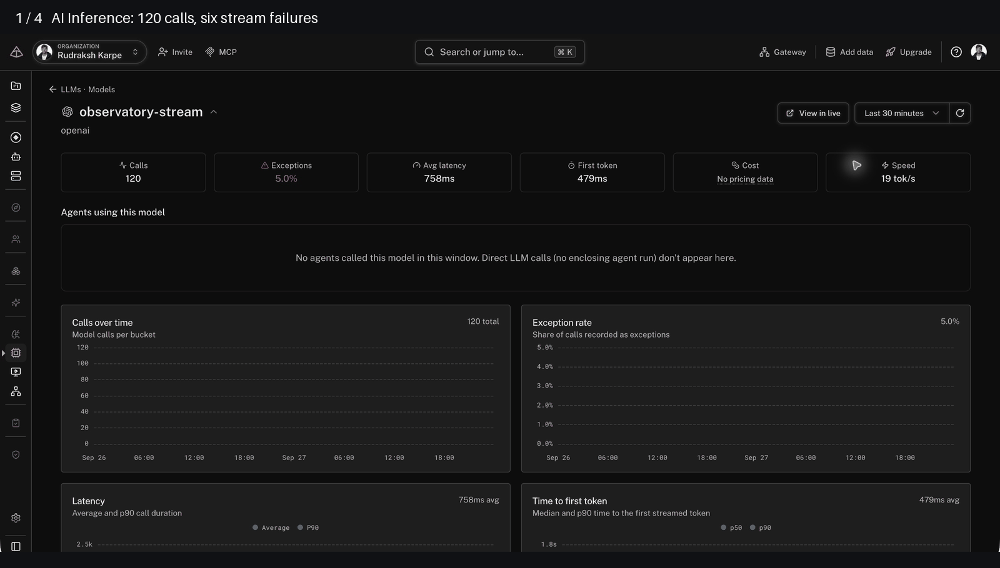
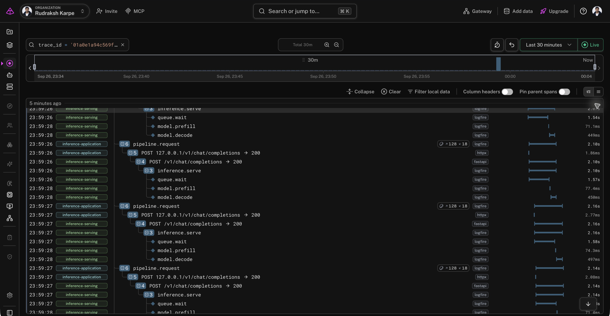
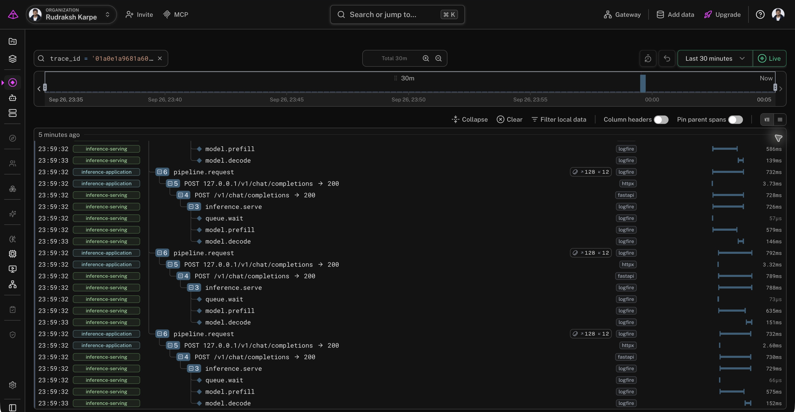
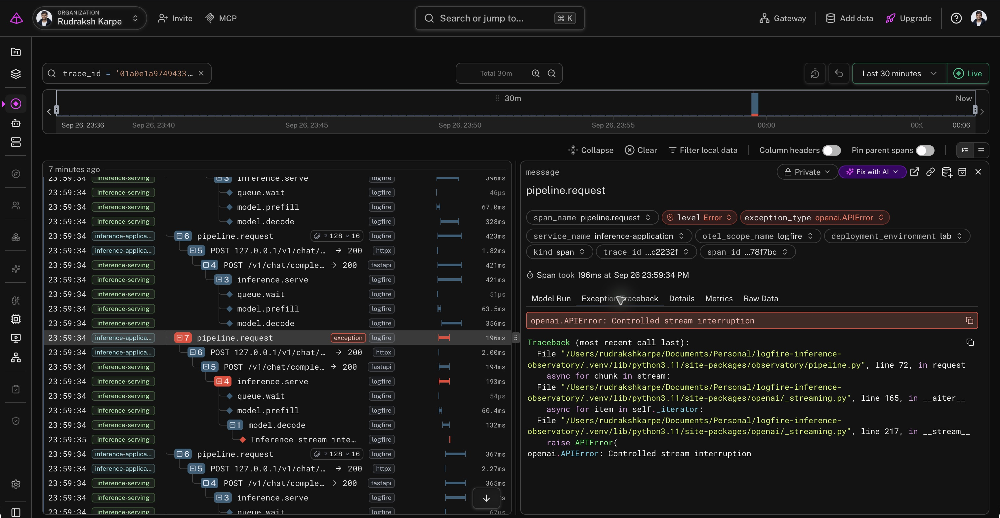

# Logfire Inference Lab

**Follow a streamed inference request from the application to the serving queue, prefill and decode stages in Pydantic Logfire.**

This is a runnable integration reference for diagnosing slow first responses and failed streams. It connects an OpenAI-compatible serving endpoint to an asynchronous client, propagates trace context between the two processes, and uses Logfire's own AI Inference and Live views for investigation.



*A 10.8-second walkthrough with zoomed excerpts and highlights from actual Logfire screenshots. The included backend generates controlled workloads without model weights or a GPU. Trace export and HTTP streaming are real; token counts are fixture units. [Capture details](docs/assets/README.md).*

## What you can investigate

A slow first response can originate in admission queueing, model preparation, or the path back to the client. A successful HTTP status can still precede a failed generation. This project makes those cases reproducible and keeps their evidence in one trace.

- Trace an OpenAI SDK request across HTTP into an instrumented FastAPI serving process.
- Compare queue pressure with slow prefill, then check the effect of restoring serving capacity.
- Observe failures after content has already streamed, with missing final usage kept missing.
- Verify parent relationships locally and read back matching records from hosted Logfire.

The stack is **Python, Pydantic, FastAPI, the OpenAI Python client, Logfire and OpenTelemetry**. There is no application frontend. The lockfile fixes the environment used for the captured run, including Logfire 5.1.1 and OpenAI 3.19.2.

## Run it

You need Python 3.11 or newer and [uv](https://docs.astral.sh/uv/getting-started/installation/). Run commands from the repository root.

```bash
git clone https://github.com/rudrakshkarpe/logfire-inference-lab.git
cd logfire-inference-lab
uv sync --locked --no-editable
cp .env.example .env
```

The default configuration runs locally with hosted export disabled. Start the serving process in one terminal:

```bash
uv run --no-editable observatory serve
```

In another terminal:

```bash
uv run --no-editable observatory doctor
uv run --no-editable observatory run --scenario baseline
uv run --no-editable python scripts/demo.py
```

The service binds to `127.0.0.1:8877`. The demo runs five scenarios sequentially, with 24 requests each, concurrency eight and seed 42. It writes summaries to `artifacts/`, measurements to SQLite under `data/`, and redacted span evidence to `data/*-spans.jsonl`. These generated paths are ignored by Git.

Use `--requests`, `--concurrency` and `--seed` with `observatory run` to change a single experiment. Limits are 120 requests and concurrency 32 per run. A fixed seed reproduces workload targets, not identical timings on every machine.

### Connect both processes to Logfire

For the US region, authenticate and select your own existing project:

```bash
uv run --no-editable logfire --region us auth
uv run --no-editable logfire --region us projects use --org YOUR-ORG YOUR-PROJECT
```

Update `.env`:

```dotenv
OBSERVATORY_EXPORT=true
LOGFIRE_BASE_URL=https://logfire-us.pydantic.dev
OBSERVATORY_PROJECT_URL=https://logfire-us.pydantic.dev/YOUR-ORG/YOUR-PROJECT
```

The SDK reads the selected project's local credentials. Alternatively, set `LOGFIRE_TOKEN` to a project write token through your environment or ignored `.env`. Keep the token and endpoint in the same region. Restart the serving process after configuration changes, then rerun the demo. It prints a Logfire link for each run.

The project URL is only used for links. It does not configure authentication or change the destination of exported data. Both processes must use the same project credentials to appear together.

### Verify the integration

```bash
# Substitute a trace ID printed by the demo.
uv run --no-editable python scripts/verify_traces.py YOUR_TRACE_ID
```

The result counts application spans, serving spans, and actual client-to-server parent links. A standard 24-request run has 24 cross-process parent links.

For optional hosted verification, create a project-scoped read token using Logfire's CLI and keep the saved file ignored:

```bash
uv run --no-editable logfire --region us read-tokens create --save
uv run --no-editable python scripts/verify_hosted.py
```

The command reads the latest `artifacts/walkthrough.json`, restricts SQL to its trace IDs, and checks request/error counts against the local results. Credentials are never printed. Allow ingestion to complete before retrying a count mismatch. It saves its response under `artifacts/hosted-verification.json`.

## Recorded result

The captured run sent **120 requests across five traces** to Logfire. There were **six intentional stream failures**, giving the model overview a **5% exception rate**. All three saved SQL queries were executed against the hosted records, rather than assuming a successful SDK flush meant ingestion had completed.

| Scenario | Requests | Errors | p95 first content | p95 queue wait | p95 prefill |
|---|---:|---:|---:|---:|---:|
| Baseline | 24 | 0 | 125 ms | 0.48 ms | 61 ms |
| Queue pressure | 24 | 0 | 1,749 ms | 1,656 ms | 79 ms |
| Slow prefill | 24 | 0 | 768 ms | 0.57 ms | 721 ms |
| Interrupted stream | 24 | 6 | 121 ms | 0.59 ms | 69 ms |
| Recovery | 24 | 0 | 140 ms | 0.85 ms | 78 ms |

These are nearest-rank percentiles from local elapsed measurements. Queue/prefill values for failed streams are absent, so that row's stage percentiles use only the 18 completed streams. [Exact results and hosted aggregates](docs/evidence/verified-run.json) include the trace IDs and capture window.

### Queue pressure versus slow prefill



In the queue-pressure trace, roughly 1.6 seconds is spent waiting for admission. Prefill is still around 70–80 ms. The application sees a slow first response, but the serving spans show why. Restoring capacity from two slots to eight reduces that wait while retaining the same work targets.



Slow prefill produces a different signature: queue waits are tiny, while preparation occupies most of the request. Client latency alone cannot distinguish these cases.

### A 200 response can still fail



The interrupted-stream scenario fails every fourth request after six content chunks. Logfire shows the HTTP 200 underneath an application span carrying `openai.APIError`. Final token usage is absent on those failed requests. The visible traceback comes from consuming the stream, not opening the connection.

## How the integration works

```text
Application process                  Serving process
workload.run
  pipeline.request
    HTTP client POST ──traceparent──► POST /v1/chat/completions
                                       inference.serve
                                         queue.wait
                                         model.prefill
                                         model.decode
```

The GenAI span stays open until the client finishes consuming the stream. HTTPX injects trace context, FastAPI extracts it, and the serving stages execute inside the streaming generator. Each process exports to the same Logfire project under its own service name.

The first version of the integration exposed a counting problem: automatic OpenAI instrumentation created separate request and streaming records in our tested SDK versions. The current implementation uses one explicit model-call span, retains HTTP transport instrumentation, and tests that its duration includes stream consumption.

Read the [integration guide](docs/integration.md) for the code walkthrough, stage placement, context propagation and engine adaptation. The [telemetry contract](docs/telemetry.md) defines every timer, usage field, metric and failure boundary. [SQL examples](queries/README.md) support investigation without another UI.

## Development and containers

```bash
make lint
make test

# Uses .env; requires a write token there if container export is enabled.
docker compose up --build
```

Use the container instead of the local serving process because both bind port 8877. The application CLI still runs on the host. The container runs as a non-root user and publishes only to loopback. Host CLI credentials are not copied into the image. See [operations and troubleshooting](docs/operations.md) for configuration, validation and credential handling.

The local suite has 14 tests, including subprocess client/server integration, trace-parent continuity, error semantics, and timing signatures. The Docker image was built and its health endpoint and SSE completion were exercised. [GitHub Actions passed on Python 3.11 and 3.13](https://github.com/rudrakshkarpe/logfire-inference-lab/actions/runs/36302500168), including lint, formatting and the full test suite.

## Extending to a real engine

The included backend is verified. vLLM, SGLang and TensorRT-LLM adapters are not implemented or tested here. An engine adapter must replace fixture controls, preserve the real engine's usage and error contract, and establish serving-side instrumentation. Simply changing the base URL is insufficient.

The current evidence proves the observability integration. A hardware-backed run would add a separate validation layer for engine scheduling, tokenizer usage and GPU metrics. The [adaptation checklist](docs/integration.md#adapting-to-an-inference-engine) explains that boundary.

MIT licensed.
