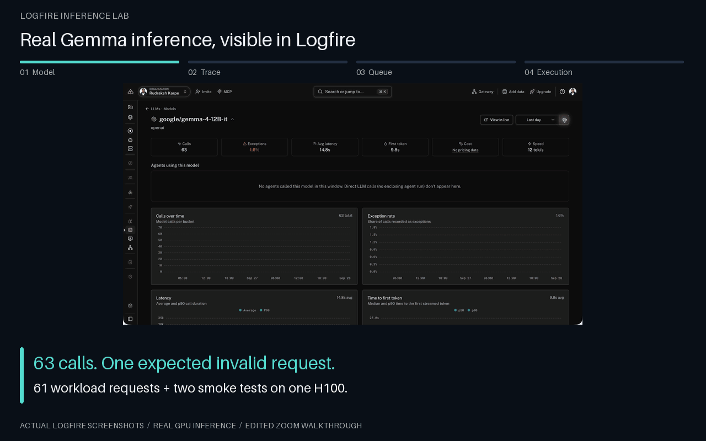
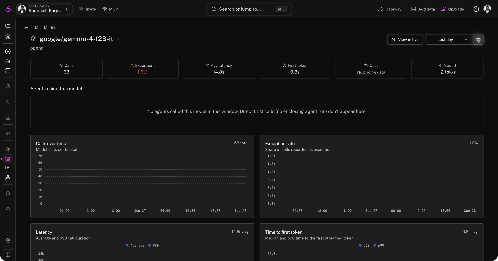
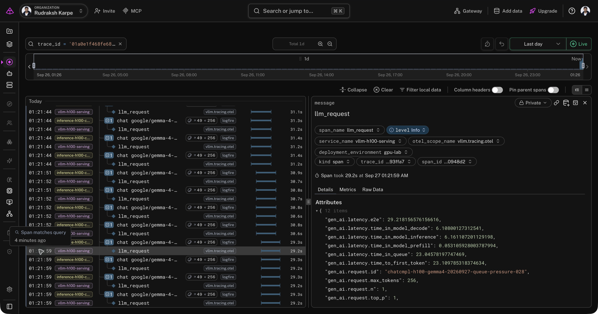

# Gemma 4 inference on an H100, traced in Logfire

On September 27, 2026, this project served `google/gemma-4-12B-it` through vLLM 0.30.0 on one NVIDIA H100 80GB HBM3. The main workload ran from 08:20:59 to 08:23:17 UTC. It produced 61 application records and 56 matching native engine request spans in Logfire. Each completed request's engine span had the application's exact span ID as its parent, and its input/output token counts matched the streamed usage.

[Machine-readable results](evidence/gemma4-h100-run.json) include the trace IDs, client versions, nearest-rank percentiles and hosted verification. The original laptop fixture remains available; these results come from loaded model weights and actual GPU execution.



*Edited zooms and highlights over actual Logfire screenshots. Static screenshots and the exact selected-request values appear below.*

## Configuration

| Setting | Captured value |
|---|---|
| Model | `google/gemma-4-12B-it` |
| Model revision | `707f0a3b8a3c7ad586ed01e27eafbad8a27dd0f7` |
| Engine | vLLM 0.30.0, PyTorch 2.13.0, Transformers 5.17.0 |
| Hardware | One H100 80GB HBM3, driver 580.126.09 |
| Precision and input | BF16, text-only |
| Context limit | 8,192 tokens |
| Scheduler limit | Four active sequences |
| Execution | Eager, prefix caching disabled, detailed tracing enabled |
| Sampling | Temperature 0, seed 42, thinking disabled, `ignore_eos=True` |
| Client | OpenAI 3.19.2, Logfire 5.1.1, retries disabled |

The launch script pins the model revision. Model weights occupied about 22.83 GiB of GPU memory; vLLM also reserved a KV cache. The GPU samples reached 100% utilization during the session. We kept downloaded weights in RAM-backed storage because the Pod's disk was limited. We archived the model identifier and revision, not its weights.

Eager execution, detailed tracing and the deliberate four-sequence limit make a short diagnostic capture practical. They do not represent a tuned H100 throughput configuration. A preliminary two-request smoke test absorbed startup compilation; it is excluded from the main scenario percentiles.

## Integration path

```text
Local workload process                         Runpod H100
  gpu.workload baseline                          vLLM API / scheduler
    chat google/gemma-4-12B-it --traceparent-->      llm_request
              |                                    |
              | OTLP/HTTP                          | OTLP/HTTP over reverse SSH
              v                                    v
                    Local archive receiver
                      |-- immutable protobuf + checksums
                      `-- authenticated forwarding --> Logfire
```

The application connects through an SSH local forward to vLLM's loopback endpoint. A reverse forward carries native engine telemetry to the local archive receiver. The model endpoint is not published on a public HTTP port, and the Logfire token stays on the laptop.

The application opens one explicit GenAI span around the entire streamed response, including stream consumption. It injects W3C `traceparent` into the request headers using OpenTelemetry propagation. vLLM extracts that context and emits its own `llm_request` span. This capture does not add automatic OpenAI instrumentation on top of the explicit span.

The native span contains queue wait, time to first token, prefill, decode and total request timing. These are vLLM request statistics in seconds. We preserve their names and units instead of generating artificial stage spans. They are not GPU kernel profiles. The server also returns per-request metrics in its streaming extension, saved alongside the chunks.

The client records `gen_ai.operation.name=chat`, model names and final usage so the model appears in Logfire's AI Inference view. The `openai` provider label describes the OpenAI-compatible integration convention; inference ran locally on the Pod. No requests were sent to OpenAI's hosted API.

## Results

| Scenario | Requests | Client concurrency | Output limit | p95 first content | p95 engine queue | p95 engine prefill |
|---|---:|---:|---:|---:|---:|---:|
| Baseline | 8 | 1 | 128 | 0.282 s | 0.053 ms | 57.48 ms |
| Queue pressure | 32 | 16 | 256 | 25.681 s | 25.379 s | 76.48 ms |
| Long context | 8 | 2 | 128 | 3.977 s | 0.056 ms | 3.444 s |
| Recovery | 8 | 1 | 128 | 0.254 s | 0.058 ms | 52.72 ms |

These are nearest-rank p95 values from small, controlled samples. Client first-content time includes network and SSH transport and excludes waiting for the client's concurrency slot. Engine timings come from native spans. Different columns' percentiles may belong to different requests and must not be added together.

Queue pressure sends 16 concurrent requests into a server scheduling at most four sequences. vLLM's log recorded four running and twelve waiting requests. Both concurrency and output length differ from baseline; this is a diagnostic contention scenario, not an isolated performance comparison. The queue attribution comes directly from native timing.

Long-context requests contain approximately 6,400 input tokens. Their high prefill time coexists with negligible queue wait. Recovery returns to baseline concurrency and prompt/output sizes without changing the server configuration. Its first-content timing returns near baseline.

The 56 completed main-workload requests consumed **53,742 input tokens** and generated **11,264 output tokens**. `ignore_eos=True` deliberately holds each valid completion to its output limit, so the high `length` finish-reason rate is expected.

### What Logfire shows



The dashboard contains the 61 main requests plus two smoke requests. Its single exception is the deliberately invalid request. The four intentional early closures appear as successful application spans because the client deliberately closes the stream without raising an exception; that label does not mean generation completed. Their saved status is `intentional_early_close`, and final usage remains null in the archive even where the dashboard renders zero.



The selected queue-pressure request spent **23.046 s in the engine queue**, **0.053 s in prefill**, and **6.108 s in decode**. The native request took 29.218 s overall. Its application parent and sibling requests remain visible on the left. The queue explains most of the slow first response.

The screenshots are actual Logfire captures with browser chrome cropped out. They do not reconstruct or modify dashboard values.

### Failure and closure coverage

The invalid-request case asks for 9,000 output tokens against an 8,192-token context limit. vLLM rejects it with HTTP 400, the SDK raises `BadRequestError`, and the application span records the exception. This is a pre-generation validation failure, not a mid-stream engine failure.

Four requests deliberately close after five content chunks. The archive preserves what arrived and does not estimate final usage. No native `llm_request` child was observed for those four requests in this capture. This establishes client-side early-closure behavior only; it does not prove a complete server-side cancellation trace or cancellation latency.

## Verification and durable evidence

The archive receiver writes and fsyncs each original protobuf batch before forwarding. The receipt journal records the payload hash and remote HTTP status. All 91 recorded forwards returned HTTP 200. Successful forwarding is not treated as proof of ingestion: a separate Logfire SQL query read back all 61 client records and all 56 expected native children, checking exact parent relationships.

The raw archive includes startup spans from earlier abandoned launch attempts. Main-workload verification is restricted to its recorded request and trace IDs. Aggregate archive span counts therefore include more than the main workload.

Saved evidence contains:

- Original OTLP protobuf batches, decoded JSON for inspection and SHA-256 receipts.
- Full generated test prompts, timestamped response chunks, usage and SDK errors.
- Request indexes, scenario configuration, trace IDs and hosted SQL results.
- Prometheus snapshots before and after each scenario.
- 584 GPU utilization, memory, power and temperature samples.
- Engine/client versions, model metadata, launch command and engine logs.
- Actual Logfire screenshots and shutdown verification.

Credentials and SSH private keys are excluded. The durable local backup sits outside the repository's ignored artifact folder and includes a checksum manifest and compressed copy. Raw captures are not committed to the public repository.

A loopback replay check verified preservation of parent relationships, durations and attributes, while assigning new trace IDs and uniformly shifting timestamps. The replay tool marks replayed resources and leaves original files unchanged. This validates the portable transport path; ingestion into Dash0 has not been tested. Prometheus snapshots and GPU CSV are separate evidence and are not replayed as OTLP traces.

The API and model worker were stopped gracefully after local backup and hosted verification. At 08:25:33 UTC, `nvidia-smi` reported no compute processes, 0 MiB GPU memory used and 0% utilization. Stopping the model does not stop Runpod Pod billing.

## Reproduce or replay

Use the [capture tool instructions](../scripts/gpu/README.md) for setup and replay. They are intentionally separate from the fixture CLI: the GPU client sends real model requests, accepts vLLM's streaming usage contract and verifies exported parent IDs instead of requiring fixture-specific response fields.

SGLang, TensorRT-LLM, other Gemma sizes, multimodal inputs and other vLLM versions have not been validated by this run. A future engine integration should repeat the trace-parent, token-usage, failure and closure checks with its own versioned evidence.
