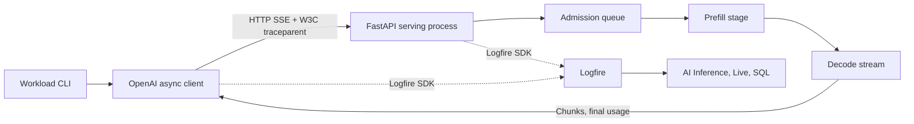

# Integrating an inference pipeline with Logfire

This reference separates three responsibilities: the application that consumes a response, the service that streams it, and Logfire as the investigation interface. Python, Pydantic, FastAPI, the OpenAI Python client, and Logfire/OpenTelemetry are the integration stack. There is no frontend to deploy.

The included serving backend is a deterministic workload fixture. It performs actual HTTP streaming, queue admission, asynchronous stage work, exception handling and telemetry export. Its timings are measured elapsed time. It does not load model weights, tokenize prompts or run GPU kernels. This makes the integration reproducible on a laptop while leaving engine-specific instrumentation as an explicit next step.

## Request and telemetry paths



Both processes export directly through the Logfire SDK. An OpenTelemetry Collector is not required for this setup and is not part of the verified path. Local redacted span capture and SQLite records let you check the same request without depending on hosted ingestion.

### 1. Configure each process before instrumenting it

`telemetry.configure()` sets separate `service_name` values: `inference-application` and `inference-serving`. Both use environment `lab` and the same project and regional endpoint. This makes the service boundary visible without splitting the trace into separate projects.

```python
logfire.configure(
    send_to_logfire=settings.observatory_export,
    service_name=service_name,
    environment="lab",
    distributed_tracing=True,
    # Project token, regional endpoint and local capture are configured here too.
)
```

The actual implementation is in [`telemetry.py`](../src/observatory/telemetry.py). `distributed_tracing=True` is appropriate for this local, trusted service boundary. Before exposing a service publicly, decide where to accept external trace context and add authentication and admission controls.

The SDK exports asynchronously. The CLI explicitly flushes before exiting; the serving process flushes during graceful shutdown. A completed flush is a local exporter result. [`verify_hosted.py`](../scripts/verify_hosted.py) separately checks that matching records reached Logfire.

### 2. Keep the application span open through stream consumption

[`pipeline.py`](../src/observatory/pipeline.py) uses `AsyncOpenAI` against `/v1/chat/completions`. The client has a 30-second timeout and disables automatic retries, so a single workload request corresponds to one observed attempt.

A `workload.run` span encloses a bounded set of concurrent `pipeline.request` spans. The concurrency semaphore sits outside each request span, so client-side waiting for a workload slot is deliberately excluded from request latency.

```python
with span("pipeline.request", **model_attributes) as request_span:
    stream = await client.chat.completions.create(
        model="observatory-stream",
        messages=messages,
        stream=True,
        stream_options={"include_usage": True},
        extra_body=workload_controls,
    )
    async with stream:
        async for chunk in stream:
            # Record the first chunk, first content, and final usage here.
            ...
    # Confirm trace continuity and attach final usage before ending the span.
```

These are abbreviated extracts; the linked source is runnable. The model attributes include `gen_ai.operation.name=chat`, request/response model names, provider name, final usage and the time to first chunk. They make the request visible in Logfire's AI Inference views.

One explicit GenAI span covers the full stream. This matters because a successful HTTP response only confirms that headers arrived. In this project's initial run with Logfire 5.1.1 and OpenAI 3.19.2, automatic OpenAI instrumentation produced separate request and streaming records: the inventory showed twice the expected count and a header-duration latency. This project uses the explicit span instead of adding automatic OpenAI instrumentation on top. A regression test checks one model-call span per request, with a lifetime extending past the first chunk.

`gen_ai.provider.name=openai` identifies the protocol/integration convention here. The model is named `observatory-stream`, and source attributes identify the local workload. No requests are sent to OpenAI's API.

### 3. Propagate context across the actual HTTP boundary

`logfire.instrument_httpx()` instruments the client's HTTP transport. `logfire.instrument_fastapi(app)` instruments the receiving ASGI application. W3C trace context is injected into the outbound request and extracted on the server.

The expected hierarchy is:

```text
workload.run                            inference-application
└── pipeline.request                    inference-application
    └── HTTP client POST                 inference-application
        └── POST /v1/chat/completions     inference-serving
            └── inference.serve          inference-serving
                ├── queue.wait
                ├── model.prefill
                └── model.decode
```

The fixture returns its active trace ID in the final chunk. The application compares it with its own trace ID. Tests also inspect exported parent IDs, verifying that the server span is a child of a client span across separate processes. Matching trace IDs alone would be a weaker check.

The HTTP client span may end after response headers while its downstream server span continues. That transport span is not the full generation timer. `pipeline.request` is the timer that encloses consumption of the response.

### 4. Instrument serving stages where the work happens

[`serving.py`](../src/observatory/serving.py) opens `inference.serve` inside the asynchronous response generator, not just inside the route handler. A span around the handler alone would end when it returned a `StreamingResponse` object.

- `queue.wait` measures the time spent acquiring an inference slot.
- `model.prefill` encloses preparation before the first generated content.
- `model.decode` encloses the sequence of streamed content chunks.

Each run has its own admission pool. Queue pressure reduces slots from eight to two. Recovery restores eight slots while retaining the same prefill and decode targets as queue pressure. The in-memory pool map is capped at 128 keys and never evicts a pool with active requests.

The server emits ordinary SSE records, a finish record, a final usage record and `[DONE]`. An interrupted stream instead emits an error after six content chunks. The HTTP status remains 200 because headers have already been sent. The client SDK raises `APIError`, and the enclosing application span records the exception. There is no retry that could hide the failure or inflate counts.

### 5. Investigate in Logfire

1. Under **AI Inference → LLMs and providers**, open the `observatory-stream` model. This is the overview of completed calls, exception rate and streamed response timing.
2. Use **Live** and the trace ID printed by the demo. Expand `pipeline.request` through the HTTP boundary to the serving stages.
3. Compare the queue-pressure and slow-prefill traces. Both delay the first content, but only queue pressure has long `queue.wait` spans.
4. Inspect interrupted streams. An HTTP 200 and a failed model call can coexist. Final token usage is absent on failed calls.
5. Use [`queries/`](../queries/) to count completed calls or aggregate server stages. Restrict the time window to the experiment.

The supplied screenshots are actual captures of these views. Logfire is the entire investigation interface.

## Adapting to an inference engine

The application/serving split and trace-context checks are engine-independent design choices. The fixture's stage implementation and its extra `observatory` payload are specific to this repository.

| Target | Current status | Work needed before claiming support |
|---|---|---|
| Included serving fixture | Executed locally, in a container, and exported to Logfire | Reproduce the documented run |
| vLLM | Not tested in this project | Use its supported client API; configure engine tracing; verify parent relationships and actual stage semantics |
| SGLang | Not tested in this project | Verify its streaming/usage contract and tracing support for the chosen release |
| TensorRT-LLM | Not tested in this project | Identify the deployed serving frontend, instrument its request boundary, and map backend timing sources |

Changing `OBSERVATORY_SERVING_URL` alone is not a complete engine adapter. The current client sends fixture controls and requires a returned trace ID. A real adapter must remove those controls, accept the engine's model name, handle its usage/error contract, and verify continuity from exported spans instead of requiring the fixture extension.

Application spans can measure client latency and usage returned by the server. They cannot reveal scheduler wait, KV-cache pressure or GPU execution time by themselves. Those require engine-side traces or metrics with clearly defined units and boundaries. Keep unavailable measurements absent. Do not infer them from client duration.

After an engine adapter exists, repeat the protocol and trace-parent tests, run a hardware-backed workload, then replace the fixture evidence with separately identified engine evidence. The current report is an integration test, not a model benchmark.

## References

- [Logfire OpenAI integration](https://pydantic.dev/docs/logfire/integrations/llms/openai/)
- [Logfire AI Inference views](https://pydantic.dev/docs/logfire/observe/llms/)
- [Logfire distributed tracing guide](https://github.com/pydantic/logfire/blob/main/docs/how-to-guides/distributed-tracing.md)
- [Pydantic AI's OpenAI-compatible model documentation](https://pydantic.dev/docs/ai/models/openai/)
